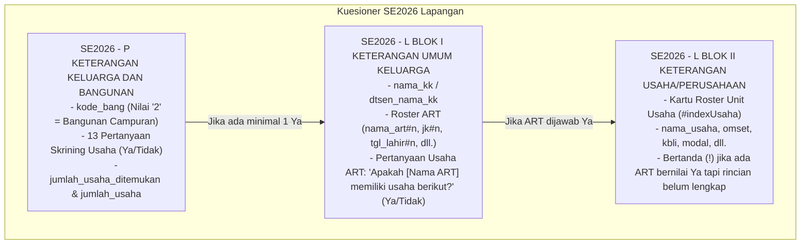
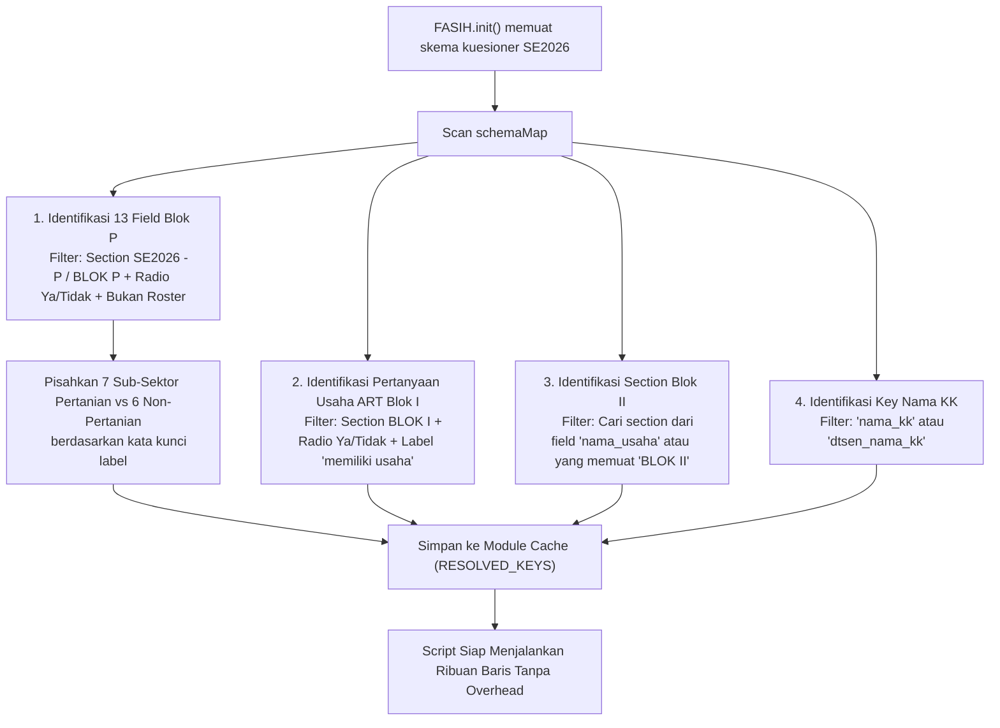
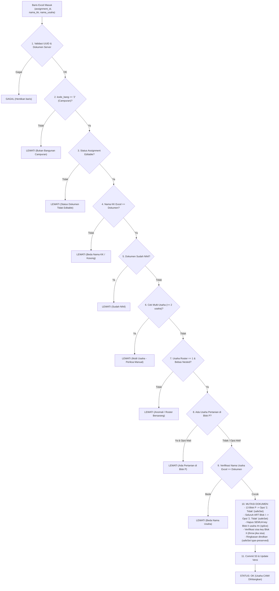

# IMPLEMENTATION PLAN: OTOMASI PENYESUAIAN USAHA CAWI (SE2026)
## Versi Plug-and-Play (Auto-Discovery Skema, Bebas `TODO_VERIFY`, Siap Pakai)

---

## 1. Ringkasan Eksekutif & Tujuan

### Masalah Saat Ini
File script [`batch-automation - penyesuaian usaha cawi.js`](file:///c:/Penyimpanan%20Utama/Downloads/Fasihbatch/fasih-extension-main/batch-automation%20-%20penyesuaian%20usaha%20cawi.js) saat ini memiliki "gembok pengaman" berupa placeholder `'TODO_VERIFY'` pada baris 30–70. Jika script ini langsung dikirim ke atasan dan di-import ke ekstensi FASIH Batch, eksekusi akan langsung ditolak dengan error:
> `[KONSTANTA BELUM DIISI DARI T-01] Script menolak berjalan dengan tebakan!`

Hal ini bertolak belakang dengan pola kerja pengguna dan atasan pada task otomasi lainnya (seperti [`batch-automation - update rincian usaha.js`](file:///c:/Penyimpanan%20Utama/Downloads/Fasihbatch/fasih-extension-main/batch-automation%20-%20update%20rincian%20usaha.js)), di mana script harus **100% *plug-and-play***:
1. Klik tombol **"Import script"**.
2. Masukkan / tempel data Excel target.
3. Klik tombol **"Mulai"** (eksekusi berjalan lancar tanpa perlu utak-atik kode).

### Solusi yang Direncanakan
Membuat script menjadi **sepenuhnya mandiri dan otomatis (*self-resolving*)** menggunakan mekanisme **Auto-Discovery Skema Terverifikasi**:
- Menghapus kewajiban pengisian manual dan menghapus error gembok `'TODO_VERIFY'`.
- Memanfaatkan struktur kuesioner SE2026 yang **sudah terverifikasi dari screenshot asli** ([`1.jfif`](file:///c:/Penyimpanan%20Utama/Downloads/Fasihbatch/fasih-extension-main/1.jfif) s.d [`4.jfif`](file:///c:/Penyimpanan%20Utama/Downloads/Fasihbatch/fasih-extension-main/4.jfif)).
- Script secara otomatis membaca metadata skema kuesioner saat baris pertama diproses melalui `FASIH.init()` dan memetakan field Blok P, Blok I, dan Blok II secara presisi di memori (*cached*).
- Menjaga 100% prinsip integritas data warga: validasi `kode_bang === '2'`, verifikasi nama KK, proteksi multi-usaha ($\ge 2$ usaha wajib `LEWATI`), penanganan ketat tipe data pada `safeSet`, penghapusan seluruh roster Blok II di tempat, dan *circuit breaker*.

---

## 2. Bukti & Pemetaan Struktur Kuesioner SE2026 (Ground Truth)

Berdasarkan analisis visual mendalam terhadap berkas screenshot resmi kuesioner SE2026 pada sistem FASIH di folder proyek:



### A. Rincian Section & Field dari Bukti Gambar:
1. **Section Blok P** ([`1.jfif`](file:///c:/Penyimpanan%20Utama/Downloads/Fasihbatch/fasih-extension-main/1.jfif), [`2.jfif`](file:///c:/Penyimpanan%20Utama/Downloads/Fasihbatch/fasih-extension-main/2.jfif), [`3.jfif`](file:///c:/Penyimpanan%20Utama/Downloads/Fasihbatch/fasih-extension-main/3.jfif)):
   - **Label Section**: Memuat kata `'SE2026 - P'` atau `'BLOK P'`.
   - **13 Pertanyaan Skrining Usaha (Pilihan 1=Ya, 2=Tidak)**:
     - *6 Sektor Non-Pertanian*:
       1. Penyewaan lahan atau kontrakan atau kos-kosan.
       2. Usaha keliling (pedagang keliling, ojek, supir, dll.).
       3. Usaha online (marketplace/sosmed tanpa toko fisik).
       4. Usaha luar tempat tinggal bongkar-pasang / kaki lima / gerobak.
       5. Pemborong konstruksi / perusahaan konstruksi di tempat tinggal.
       6. Usaha lain (les privat, freelance, youtuber, konten kreator, afiliator, dll.).
     - *7 Sub-Sektor Pertanian (Header: "Identifikasi Usaha Pertanian yang Dilakukan Keluarga")*:
       7. Tanaman Pangan (padi, jagung, kedelai, palawija).
       8. Hortikultura.
       9. Perkebunan.
       10. Peternakan.
       11. Kehutanan.
       12. Perikanan.
       13. Jasa Pertanian.
   - **Field Ringkasan di Blok P**:
     - `jumlah_usaha_ditemukan`: Input readonly dengan catatan *"Jumlah usaha akan terisi dengan meng-update keberadaan usaha"*.
     - `jumlah_usaha`: Agregat hitungan jumlah usaha keluarga.

2. **Section Blok I** ([`4.jfif`](file:///c:/Penyimpanan%20Utama/Downloads/Fasihbatch/fasih-extension-main/4.jfif)):
   - **Label Section**: Memuat kata `'SE2026 - L BLOK I'` atau `'BLOK I'`.
   - **Kepala Keluarga**: Terdaftar di awal daftar anggota keluarga.
   - **Pertanyaan Usaha ART**:
     - Berada di bagian bawah setiap kartu ART: *"Apakah [NAMA ART] memiliki usaha berikut? (daftar kategori Ya di Blok P)"*.
     - Pilihan: Radio `Ya` (kode `1`) / `Tidak` (kode `2`).

3. **Section Blok II** ([`4.jfif`](file:///c:/Penyimpanan%20Utama/Downloads/Fasihbatch/fasih-extension-main/4.jfif)):
   - **Label Section**: Memuat kata `'SE2026 - L BLOK II'` atau `'BLOK II'`.
   - Seluruh field rincian unit usaha terdaftar di section ini dengan akhiran `#<nomor_usaha>`.

---

## 3. Arsitektur Auto-Discovery (Pencocokan Otomatis Dinamis)

Script akan dilengkapi fungsi resolver cerdas `resolveSchemaMetadata(schemaMap, sampleDoc)` yang berjalan **sekali saja saat inisialisasi batch (`before`)**:



### Logika Deteksi Dinamis:
1. **Deteksi Blok P**:
   ```javascript
   // Cari semua field radio Ya/Tidak non-roster di section Blok P
   const blokPRadio = [];
   for (const [key, f] of schemaMap.entries()) {
     const sec = (f.section || '').toLowerCase();
     const isSecP = sec.includes('se2026 - p') || sec.includes('blok p') || sec.includes('penapis');
     const hasOptYaTidak = Array.isArray(f.options) &&
       f.options.some(o => String(o.value) === '1') &&
       f.options.some(o => String(o.value) === '2');
     if (isSecP && hasOptYaTidak && !/#\d+/.test(key)) {
       blokPRadio.push({ key, label: f.label || '' });
     }
   }
   ```
   - **Validasi Keras**: Jika `blokPRadio.length !== 13`, script memunculkan pesan error yang jelas menyebutkan daftar field yang terdeteksi agar tidak ada salah sasaran.
   - **Pemisahan Sektor Pertanian**:
     Field yang labelnya memuat kata `tanaman pangan`, `hortikultura`, `perkebunan`, `peternakan`, `kehutanan`, `perikanan`, atau `jasa pertanian` dikelompokkan ke `BLOK_P_PERTANIAN` (7 field). Sisanya dikelompokkan ke `BLOK_P_NON_PERTANIAN` (6 field).

2. **Deteksi Pertanyaan ART Blok I**:
   - Memindai field di section yang memuat `'blok i'` dengan label yang memuat kata `'memiliki usaha'` dan memiliki opsi Ya/Tidak.

3. **Deteksi Section Blok II**:
   - Mengekstrak nama section dari field `nama_usaha` (`FASIH.schema('nama_usaha').section`), atau mencari section yang memuat kata `'blok ii'`.

4. **Whitelist Status Fleksibel**:
   - Menyediakan whitelist status dokumen operasional umum di FASIH BPS:
     `['ASSIGNED', 'IN_PROGRESS', 'REVISE', 'REVISION', 'NOT_SUBMITTED', 'OPEN', 'PENDING']`.

---

## 4. Alur Kerja Pemrosesan Per Baris (Tetap Ketat & Terverifikasi)

Setiap baris data Excel yang masuk ke ekstensi dievaluasi secara berurutan (*fail-safe pipeline*):



---

## 5. Rencana Perubahan Kode File

### File 1: `batch-automation - penyesuaian usaha cawi.js`
1. **Hapus Gembok `TODO_VERIFY` & `cekKonstantaSiap`**:
   - Hapus pengecekan yang melempar error `[KONSTANTA BELUM DIISI DARI T-01]`.
2. **Tambahkan Modul `SchemaResolver`**:
   - Fungsi `resolveKeys(doc, schemaFn)` yang mengekstrak field Blok P, Blok I, dan Blok II secara otomatis saat baris pertama berjalan.
   - Hasil deteksi disimpan di *cache* agar proses ribuan baris berikutnya berlangsung instan tanpa proses *scan* ulang.
3. **Pertahankan Fitur Unggulan yang Sudah Teruji**:
   - `safeSet` dengan penjagaan tipe data asli dokumen (`number` tetap `number`, `boolean` tetap `boolean`, `string` tetap `string`).
   - Penghapusan seluruh key `SECTION_BLOK_II` berindeks usaha tunggal tanpa whitelist `BASE_KEYS_ROSTER_BLOK_II`.
   - Perlindungan `nama_art#1` dan `catatan_umum` tetap 100% utuh.
   - *Circuit Breaker* (henti darurat pada 3 kegagalan berurutan).

### File 2: `test-penyesuaian-usaha-cawi.js`
1. Tambahkan uji unit untuk fungsi `SchemaResolver` (memastikan skema realistis SE2026 terdeteksi tepat 13 field Blok P, 7 pertanian, 6 non-pertanian, Blok I, dan Blok II).
2. Pertahankan ke-7 uji yang sudah ada (100% lulus) dengan eksekusi mandiri `node test-penyesuaian-usaha-cawi.js`.

---

## 6. Prosedur Penggunaan oleh Pengguna & Atasan (SOP Singkat)

Setelah implementasi ini diterapkan, cara kerja script akan **persis sama dengan task lainnya**:

```
[File Excel Target]  ──(Salin Baris Data)──>  [Panel FASIH Batch]
                                                      │
[batch-automation.js] ──(Klik 'Import script')────────┘
                                                      │
                                                      ▼
                                              [Klik Tombol 'Mulai']
                                                      │
                                           (Proses Otomatis Berjalan)
```

1. Buka halaman FASIH di browser $\rightarrow$ klik ikon ekstensi **FASIH Batch**.
2. Klik tombol **"Import script"** $\rightarrow$ pilih file `batch-automation - penyesuaian usaha cawi.js`.
3. Buka file Excel target Anda $\rightarrow$ salin kolom data (`assignment_id`, `nama_kk`, `nama_usaha`) $\rightarrow$ tempel ke tabel panel.
4. Pastikan centang **Dry Run** aktif untuk uji coba tanpa tulis, lalu klik **"Mulai"**.
5. Setelah hasil Dry Run berstatus `OK` dan `LEWATI` sesuai harapan, hilangkan centang Dry Run $\rightarrow$ klik **"Mulai"** untuk eksekusi LIVE.
