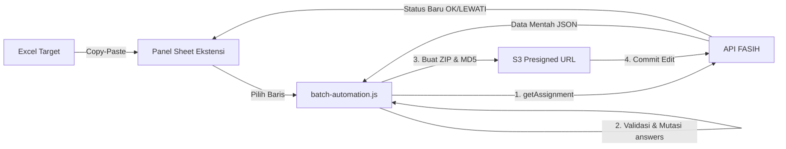
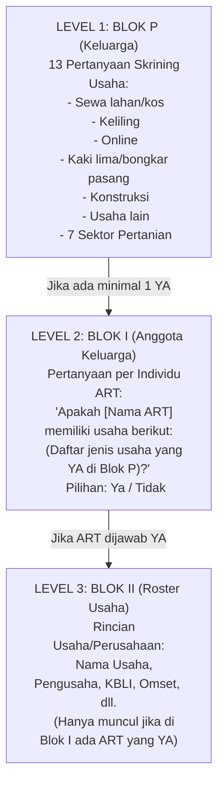
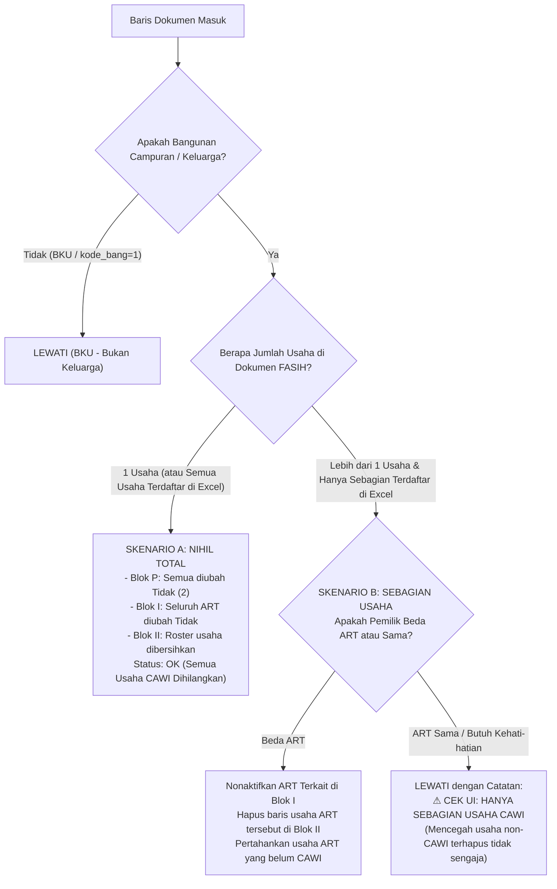

# Product Requirements Document (PRD)
## Otomasi Penyesuaian Usaha CAWI (SE2026) via FASIH Batch Extension

---

### 1. Ringkasan Proyek & Tujuan

- **Konteks Survei**: Sensus Ekonomi 2026 (SE2026) Badan Pusat Statistik (BPS).
- **Latar Belakang**: Terdapat unit usaha yang telah berhasil didata secara mandiri melalui moda **CAWI (Computer-Assisted Web Interviewing)** sebagaimana terdaftar dalam file `Target Penyisiran Slawi.xlsx`. Pada dokumen pendataan keluarga di lapangan (CAPI/FASIH), usaha-usaha yang telah tercatat via CAWI tersebut harus disesuaikan/dieliminasi agar tidak terjadi **pencatatan ganda (*double counting*)**.
- **Tujuan Sistem**: Membuat script otomasi (`batch-automation.js`) yang di-import ke ekstensi **FASIH Batch** untuk membaca data target dari Excel, memeriksa dokumen di FASIH, dan secara otomatis mengubah jawaban penapis usaha (Blok P & Blok I) serta membersihkan rincian usaha (Blok II) tanpa memicu error validasi/anomali pada FormGear FASIH.

---

### 2. Cara Kerja Ekstensi FASIH Batch

Ekstensi ini menginjeksi panel antarmuka spreadsheet ke dalam tab aktif `https://fasih-sm.bps.go.id`. 

#### Alur Eksekusi Per Baris:
1. **Fetch**: Ekstensi mengambil data mentah assignment via API internal FASIH:
   `https://fasih-sm.bps.go.id/app/api/assignment-general/api/assignment/get-by-assignment-id?assignmentId=...`
2. **Validasi Kondisi**: Memeriksa apakah dokumen berstatus Bangunan Campuran/Keluarga, apakah usaha masih aktif, dan memeriksa daftar usaha yang ada di dalam dokumen.
3. **Mutasi Data (`doc.answers`)**: Mengubah jawaban field penapis dan merapikan array jawaban sesuai skema FormGear.
4. **Kompresi & Submit**: Membungkus dokumen ke dalam file ZIP (`data.json`, `comment.json`, `media.json`), menghitung checksum MD5, mengunggah ke S3 via Presigned URL, dan melakukan *commit* ke server FASIH.

---

### 3. Struktur Hierarki Kuesioner SE2026

Kuesioner SE2026 keluarga menggunakan sistem dependensi bertingkat (3 level):

1. **Blok P (Skrining Rumah Tangga)**:
   - Jika semua dijawab `2. Tidak`, maka keluarga dinyatakan tidak memiliki usaha sama sekali.
   - Variabel `jumlah_usaha_ditemukan` / `jumlah_usaha` bernilai 0.
2. **Blok I (Atribusi Pemilik Usaha per ART)** *(lihat foto 4.jfif)*:
   - Menanyakan anggota keluarga mana yang menjalankan usaha dari kategori yang bernilai "Ya" di Blok P.
   - Jika ART dijawab `Tidak`, maka ART tersebut bukan pengusaha.
3. **Blok II (Keterangan Usaha/Perusahaan)**:
   - Berisi kartu/roster rincian usaha. Blok ini bertanda **seru merah `(!)`** jika ada ART di Blok I yang bernilai `Ya` tetapi rincian usahanya belum lengkap.

---

### 4. Aturan Logika & Penanganan Kasus Lapangan

Sistem dirancang untuk mengenali 3 tipe kasus berdasarkan data dari `Target Penyisiran Slawi.xlsx`:

#### Rincian Skenario:

#### Skenario 0: Bangunan Khusus Usaha (BKU)
- **Kondisi**: `kode_bang_label == '1. Bangunan Khusus Usaha'`.
- **Aksi**: Langsung return `{ skip: true, ket: 'BKU (bukan keluarga) — lewati' }`.
- **Tujuan**: Mencegah kerusakan kuesioner pada 5.920 baris BKU yang ada di Excel.

#### Skenario A: Keluarga dengan Tepat 1 Usaha (Target Utama - 83% Kasus)
- **Kondisi**: Dokumen keluarga/bangunan campuran di FASIH memiliki tepat 1 unit usaha yang tercatat.
- **Aksi Otomasi (Nihil Total)**:
  1. **Blok P**: Mengubah seluruh 13 pertanyaan penapis usaha menjadi `2. Tidak` (format opsi FormGear: `[{ label: '2. Tidak', value: '2' }]`).
  2. **Blok I**: Mengubah pertanyaan kepemilikan usaha pada anggota keluarga terkait menjadi `Tidak`.
  3. **Blok II**: Membersihkan seluruh entri roster usaha (`doc.answers.splice(...)` untuk field `<key>#n`), mengeset `ec_ada_usaha = false`, dan `jumlah_usaha = 0`.
- **Hasil**: Dokumen berstatus bersih/hijau tanpa anomali. Status di sheet: **`OK (Usaha CAWI Dihilangkan)`**.

#### Skenario B: Keluarga Memiliki Lebih dari 1 Usaha (>1 Usaha - 17% Kasus)
- **Kondisi**: Dokumen keluarga di FASIH memiliki 2 atau lebih unit usaha.
- **Kebijakan Keamanan**: **OTOMATIS DILEWATI (SKIP)**.
- **Alasan**: Mencegah penghapusan tidak disengaja pada usaha aktif yang belum CAWI (baik usaha milik ART lain maupun usaha kedua milik orang yang sama).
- **Aksi Otomasi**: 
  - Script tidak mengubah data dokumen sama sekali.
  - Mengembalikan status: **`LEWATI (Memiliki N usaha: [daftar usaha] — Periksa Manual)`**.
  - Versi dokumen tidak naik, data aman 100%.

---

### 5. Struktur Kolom Sheet Ekstensi (Input dari Excel)

Data yang ditempelkan (paste) dari `Target Penyisiran Slawi.xlsx` ke panel ekstensi:

| Kolom Sheet | Sumber di Excel | Tipe Data | Keterangan |
| :--- | :--- | :--- | :--- |
| **`assignment_id`** | Kolom A (`assignment_id`) | UUID (Wajib) | Kunci utama pencarian dokumen di FASIH |
| **`nama_kk`** | Kolom J (`nama_kk`) | Text (Opsional) | Pengaman: verifikasi kesesuaian nama kepala keluarga |
| **`nama_usaha`** | Kolom R (`Nama Usaha`) | Text (Opsional) | Digunakan untuk mencocokkan nama usaha spesifik |
| **`nama_pengusaha`**| Kolom S (`Nama Pengusaha`)| Text (Opsional) | Digunakan untuk mencocokkan ART pemilik usaha |
| **`kode_bang_label`**| Kolom K (`kode_bang_label`)| Text (Opsional) | Pengaman penyaring awal BKU vs Campuran |

---

### 6. Fitur Keamanan Sistem (Zero Mistake & Anti-Fatal Error)

Untuk menjamin tidak ada data yang rusak atau hilang secara permanen:

1. **Backup Otomatis Sebelum Live**:
   Sebelum update live dikirim, ekstensi memiliki fitur unduh cadangan `fasih-backup-<id>-*.json`. Jika terjadi anomali, seluruh dokumen dapat dipulihkan 100% seperti semula melalui menu **Restore**.
2. **Dry Run Tanpa Efek Samping**:
   Tombol *Dry Run* mensimulasikan proses tanpa mengirim ke server FASIH, menampilkan preview jumlah perubahan field dan alasan jika baris dilewati (LEWATI).
3. **Idempotensi (Tidak Mengulang Baris Sesuai)**:
   Jika dokumen sudah dalam keadaan tidak memiliki usaha / sudah berstatus `Tidak`, script langsung mengembalikan status `LEWATI (Usaha sudah disesuaikan)` sehingga nomor versi dokumen tidak naik secara sia-sia.
4. **Validasi Opsi Skema FormGear**:
   Semua penulisan radio/select di-coerce melalui skema FormGear (`FASIH.schema()`) agar tersimpan dalam format objek `[{ label, value }]`, mencegah error fatal *"Cannot read properties of undefined (reading 'toString')"*.

---

### 7. Rencana Tahapan Implementasi

1. **Tahap 1: Ekstraksi Skema Definitif DataKey**:
   - Membaca daftar nama variabel asli (`dataKey`) untuk ke-13 pertanyaan Blok P dan pertanyaan ART Blok I melalui tab FASIH aktif menggunakan perintah `await FASIH.init()`.
2. **Tahap 2: Pembuatan Script `batch-automation - penyesuaian usaha cawi.js`**:
   - Menyusun kode logika lengkap sesuai spesifikasi PRD ini di folder project.
3. **Tahap 3: Uji Coba 1 Dokumen Sampel (Dry Run & Live 1 Baris)**:
   - Menguji pada 1 `assignment_id` nyata dari Excel.
   - Membuka hasilnya langsung di antarmuka web FASIH untuk memastikan:
     - Blok P centang hijau.
     - Blok I centang hijau.
     - Blok II hilang/bersih dengan benar.
     - Tidak ada anomali atau tanda seru merah.
4. **Tahap 4: Eksekusi Batch Bertahap**:
   - Menjalankan secara massal per kelompok wilayah/SLS dengan jeda aman.
